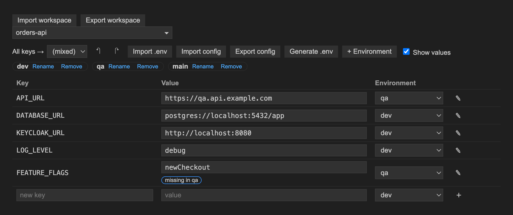
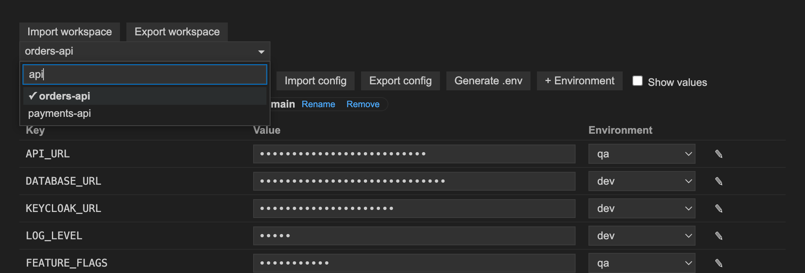
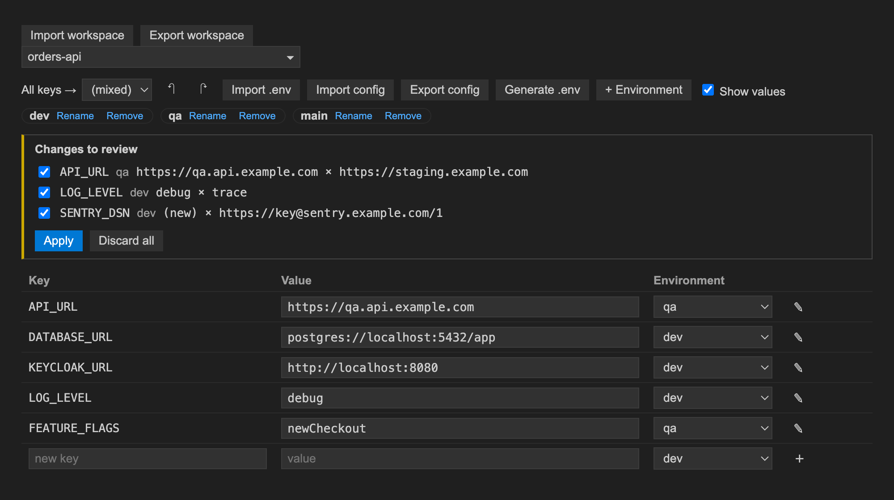
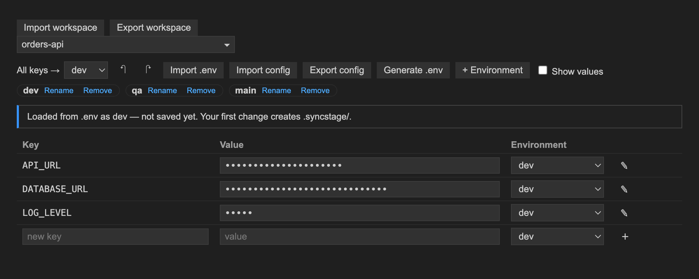
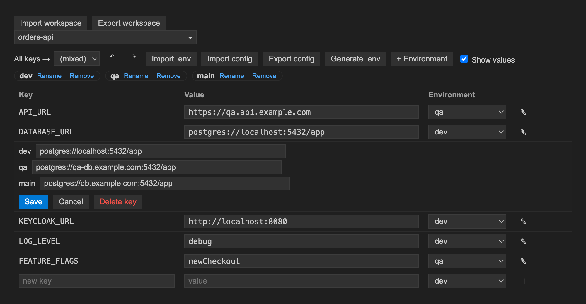

# syncstage

Switch your `.env` between dev, qa and main per key, across every project in your workspace.




## Why

In a workspace with several services, each `.env` points at a different mix of local, QA and production-like endpoints. Editing those files by hand is slow and error-prone. syncstage keeps one value per key per environment, lets you pick which environment each key uses, and writes the result to the project's `.env`.

## Features

- **Per-key environment switch.** Each key has its own dropdown; the target file updates immediately.
- **All keys.** Switch every key of a project to one environment in a single click.
- **Inline value edit.** Edit the active value in the table, or open the editor (pencil) to set every environment at once.
- **Multi-project discovery.** Finds projects (folders with a `.env` or `.syncstage/schema.json`) in all workspace folders, including nested ones.
- **Searchable project picker.** Type to filter, arrow keys and Enter to choose.

  

- **Import `.env`.** Import an existing file into an environment. New keys are added; differing values are never overwritten silently, they go to review.
- **Manual-edit detection.** If the target file is changed outside syncstage, the differences are offered for review.

  

- **Draft from existing `.env`.** A project with only a `.env` is shown as a draft; nothing is saved until your first change.

  

- **Generate `.env`.** Rewrite the target file from the current selections on demand.
- **Export / import config.** Per project, or for the whole workspace (projects are matched by folder name). Choose structure only or include values.
- **Undo / redo** per project (up to 50 steps, kept for the session).
- **Languages:** English and Portuguese (pt-BR).
- Works in VS Code, Cursor and Antigravity.



## Install

1. Download `syncstage-0.1.0.vsix` from the [Releases page](https://github.com/eduardoabrito/syncstage/releases/latest).
2. In the Extensions view, open the `…` menu and choose **Install from VSIX…**, or run:

```bash
code --install-extension syncstage-0.1.0.vsix
```

## Usage

Click the syncstage icon in the activity bar, or run **syncstage: Open panel** from the command palette. The extension also activates when the workspace contains `.syncstage/schema.json`.

Pick a project, then choose an environment per key or for all keys. Values are masked until you tick **Show values**.

## How data is stored

| File | Git | Content |
|---|---|---|
| `.syncstage/schema.json` | commit it | target file, environments, key names. No values. |
| `.syncstage/values.json` | local only | the values and current selections. Added to `.gitignore` automatically. |

The target file defaults to `.env` and can be changed per project in `schema.json`, for example to `.env.local`.

## Safety

- Nothing is written when you open the panel; a project is created on your first change.
- If the target file is tracked by git, syncstage asks before the first write (continue or change target).
- Writes are refused if the target is a symlink or resolves outside the project folder.
- Existing values are never overwritten silently: import conflicts and manual edits go to a review step.
- Exporting a config with values warns if the destination is not gitignored.

## Development

```bash
pnpm install
pnpm build      # compile extension and webview
pnpm test       # compile and run node --test
pnpm package    # build and produce syncstage-0.1.0.vsix
```

## License

[MIT](LICENSE)
